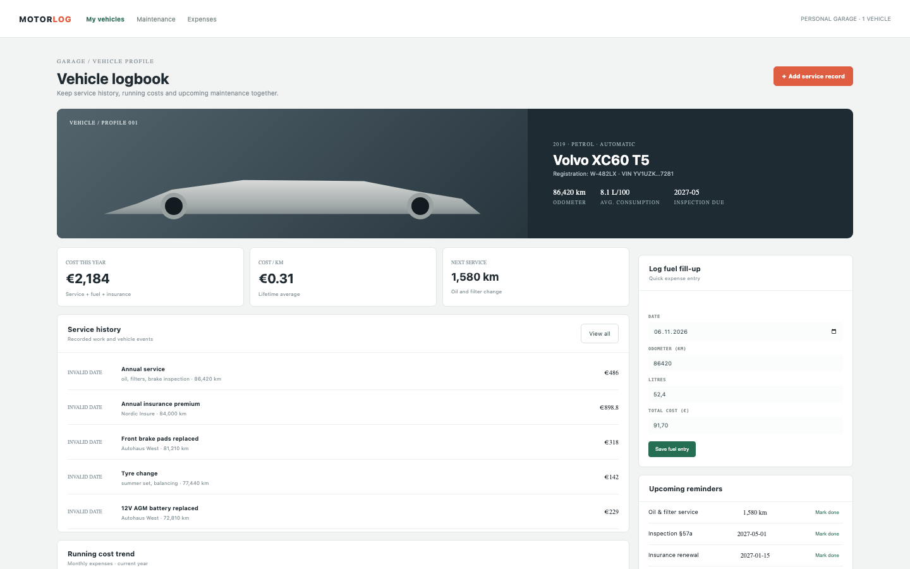

# Vehicle Log

A personal garage record: odometer, service history, fuel entries, running costs and upcoming reminders, with the VIN masked.

## Run it

```sh
npm install
npm start
```

Open the address it prints. `npm test` runs the tests (node:test; no network, no key).

## What to ask the chat next

- Log a fuel fill-up at a new odometer and check the consumption.
- Add a service record for new brake pads and review the yearly cost.
- Mark the oil-service reminder done.

## Screenshot


